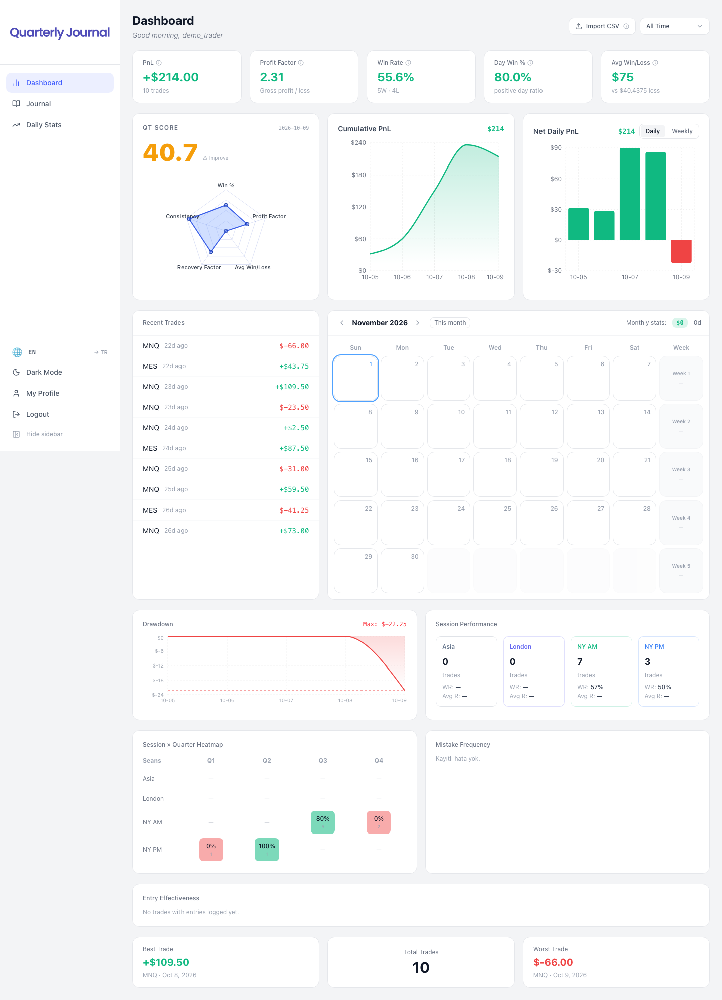
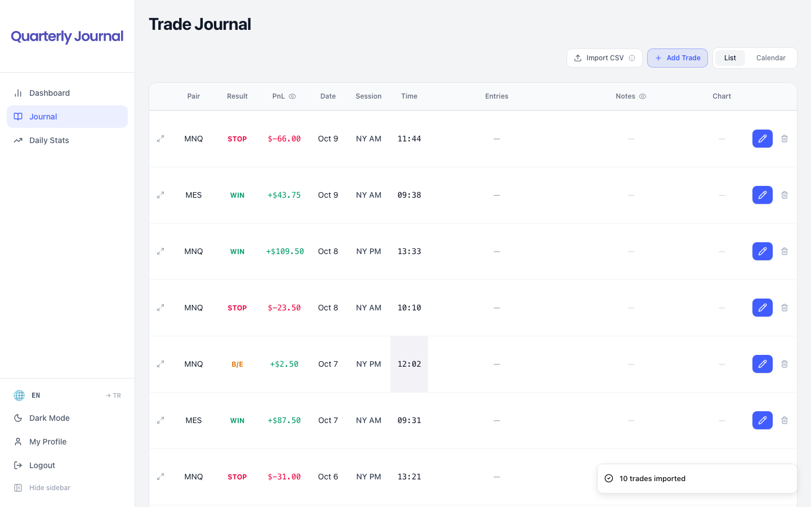
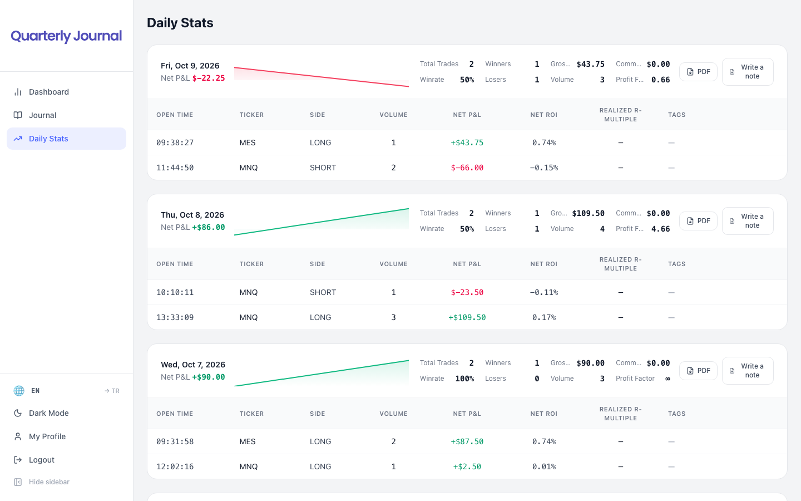

<div align="center">


### Free, open-source trading journal for futures day traders

**Quarterly Theory–native trade journal · Tradovate CSV import · QT Score · runs 100% in your browser — no account, no API key**


</div>



**Quarterly Journal** is a trade journal built for futures traders (NQ, ES, MNQ, MES, YM, RTY, GC, CL…)
who follow **Quarterly Theory** and **ICT** concepts. Generic trading journals only store entry, exit and P&L.
Quarterly Journal models every trade around the framework you actually trade — session, quarter,
90-minute micro-quarter, confirmation chain and mistakes — and turns it into statistics that show
where your edge really is.

Clone it, run it, and start journaling in under a minute. **There is nothing to sign up for and no API
key to configure**: your trades are stored in your own browser, and you can export a backup file at any time.

---

## ✨ Features

### 📒 Trade journal
- Spreadsheet-style journal with inline, double-click-to-edit cells
- Step-by-step **trade wizard**: confirmations per timeframe, chart link, R-multiple, mistakes, notes
- 60+ confirmation types — QT primitives (SSMT, PSP, PRC, SD, PO3, MMXM), ICT concepts (BOS, CHoCH, OB,
  FVG, MSS, CISD), indicators, volume tools and classic patterns — fully customisable
- Automatic session (Asia / London / NY AM / NY PM), session quarter, 90-minute micro-quarter,
  week, month and year quarter for every trade
- List and calendar views, hide P&L / notes for screenshots

### 📊 Analytics dashboard
- P&L, profit factor, win rate, day win %, average win / loss
- **QT Score**: a radar chart that grades win %, profit factor, consistency, recovery factor and avg win/loss
- Cumulative P&L, drawdown curve, daily / weekly net P&L bars
- Session performance and **Session × Quarter heatmap**, so you can see exactly which quarter pays you
- Mistake frequency and entry (confirmation) effectiveness
- Monthly P&L calendar, best / worst trade

### 📅 Daily stats
- Per-day breakdown with intraday equity curve, winners / losers, volume, profit factor
- Per-day journaling note and **one-click PDF daily report**

### ⚡ Import & sync
- **Tradovate Performance.csv import** with duplicate detection (re-importing the same file is safe)
- Time-zone aware: timestamps converted to New York time with DST handled correctly
- Manual trade entry for any broker
- Optional Tradovate auto-sync through a small Cloudflare Worker (self-hosted mode)

### 🎨 Everything else
- Light & dark theme, English & Turkish UI
- Backup / restore your whole journal as a single JSON file
- Optional live news feed, economic calendar and economic-data panel with alarms (self-hosted mode)

| Journal | Daily stats |
|---|---|
|  |  |

---

## 🚀 Quick start (no API keys)

```bash
git clone https://github.com/efkanakalin/Quarterly-Journal.git
cd Quarterly-Journal
npm install
npm run dev        # → http://localhost:5173
```

Open the app, click **Get Started**, pick a username and you are in.
Want to see it full of data straight away? Go to **Journal → Import CSV** and choose
[`examples/sample-performance.csv`](examples/sample-performance.csv).

### Importing your own trades from Tradovate
Tradovate → *Account Settings* → *Reports* → **Performance** tab → choose a date range → *Download CSV* →
Quarterly Journal → **Journal → Import CSV**.

### Where is my data?
In **local mode** (the default) every trade lives in your browser's `localStorage` and nothing is sent
anywhere. Use **My Profile → Your data → Download backup** to keep a copy or to move the journal to
another browser or computer, and **Restore from file** to load it back.

### Deploying
`npm run build` produces a static site in `dist/`. Host it for free on Cloudflare Pages, Netlify,
Vercel or GitHub Pages (SPA config for Netlify, Vercel and Cloudflare is included).

---

## ☁️ Optional: self-hosted cloud mode

Local mode covers the whole journal and all analytics. If you want **multi-device sync, accounts,
the live news panel or Tradovate auto-sync**, you can connect **your own** free Supabase project.
None of this is required.

1. Create a project at [supabase.com](https://supabase.com) and run the SQL files in
   `supabase/migrations/` in order.
2. `cp .env.example .env` and fill in `VITE_SUPABASE_URL` and `VITE_SUPABASE_ANON_KEY`
   (the public anon key; never put a service-role key in a `VITE_` variable).
3. *(News panel)* deploy the edge functions in `supabase/functions/` and set your own
   `FINNHUB_API_KEY` as a Supabase secret.
4. *(Tradovate auto-sync)* deploy the worker in `cloudflare-worker/` and set
   `VITE_TRADOVATE_WORKER_URL`.

As soon as the two Supabase variables are present the app switches from local mode to cloud mode
automatically.

---

## 🧱 Tech stack

| Layer | Tech |
|---|---|
| Frontend | React 19, TypeScript, Vite |
| Styling | Tailwind CSS v4, Base UI primitives, Lucide icons |
| State | Zustand |
| Charts | Recharts |
| CSV / dates | PapaParse, date-fns, date-fns-tz |
| PDF | jsPDF, html-to-image |
| Storage | Browser `localStorage` (default) · Supabase Postgres + RLS (optional) |

## 🤝 Contributing

Issues and pull requests are welcome. New broker CSV formats (NinjaTrader, Rithmic, TopstepX,
MetaTrader…) are especially appreciated; parsers live in `src/lib/csv/`.

## 📄 License

[MIT](LICENSE): free for personal and commercial use.

---

<sub>Keywords: trading journal, trade journal, futures trading journal, day trading journal,
Tradovate journal, Quarterly Theory, ICT, NQ / ES / MNQ / MES, trade tracker, trading statistics,
open source trading journal, free trading journal.</sub>
